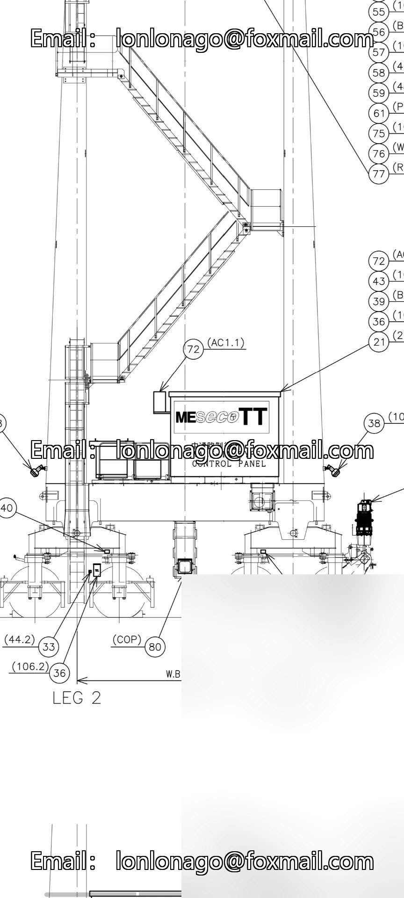
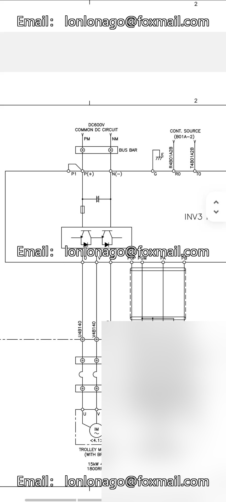
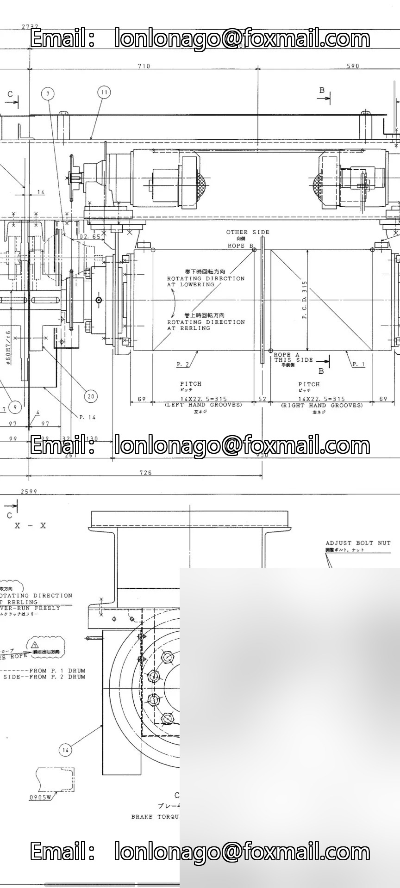
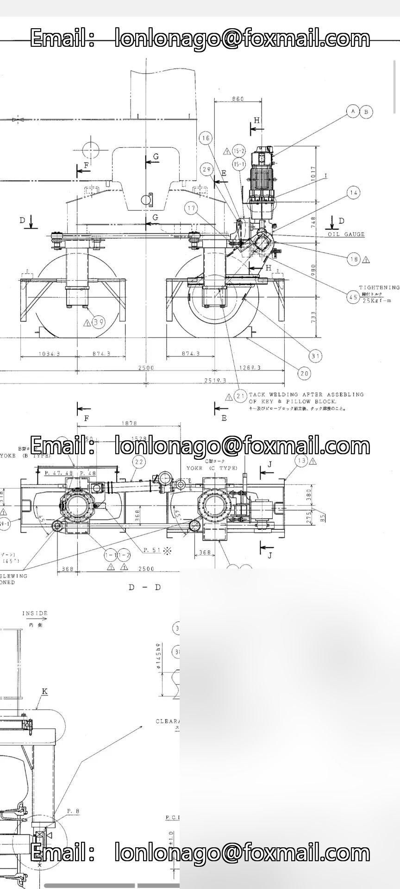
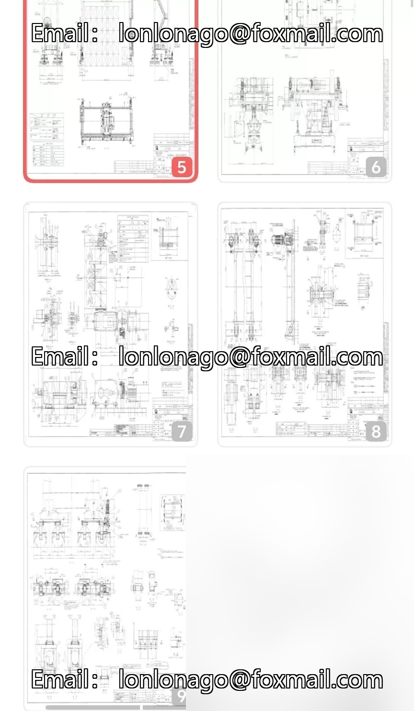

# Mitsui PACECO transport lifting drawing material

## Body

3. MITS PACECO transport crane drawing material 3. MITS / MITS-PACECO cross-deliverance vehicle / transport crane drawing material PDF file of 170 pages, content consists of drawing materials related to "cross-deliverance vehicle / transport crane" port loading and unloading equipment (rubber tire-type / rail-type container handling equipment) of MITS/MITS-PACECO, including Approval Drawings (submission drawings / approval drawings), suitable for owners, port authorities, construction supervision, vessel classification, third-party review and signature confirmation, and then entering the manufacturing, procurement or installation stages.
BT3

no return upon sale. If you need to take it directly, please send a private message for inquiries.

The materials consist of 170-page PDF files for Sanmu PACECO transfer hoisting, covering port handling equipment related drawings, approval drawings, as well as control, transmission and wiring references.

<!-- AI_ENRICHED -->

## Images

## Payment

Here is a pay link on Stripe ( https://buy.stripe.com/3cs8yP7sY87d0vu9AB ). Please contact me lonlonago@foxmail.com after funding $89, and I will send you a complete data files , thank you!

